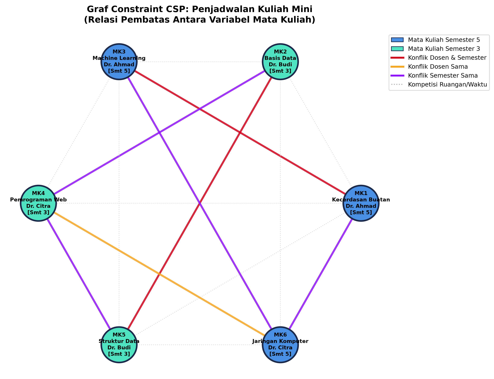
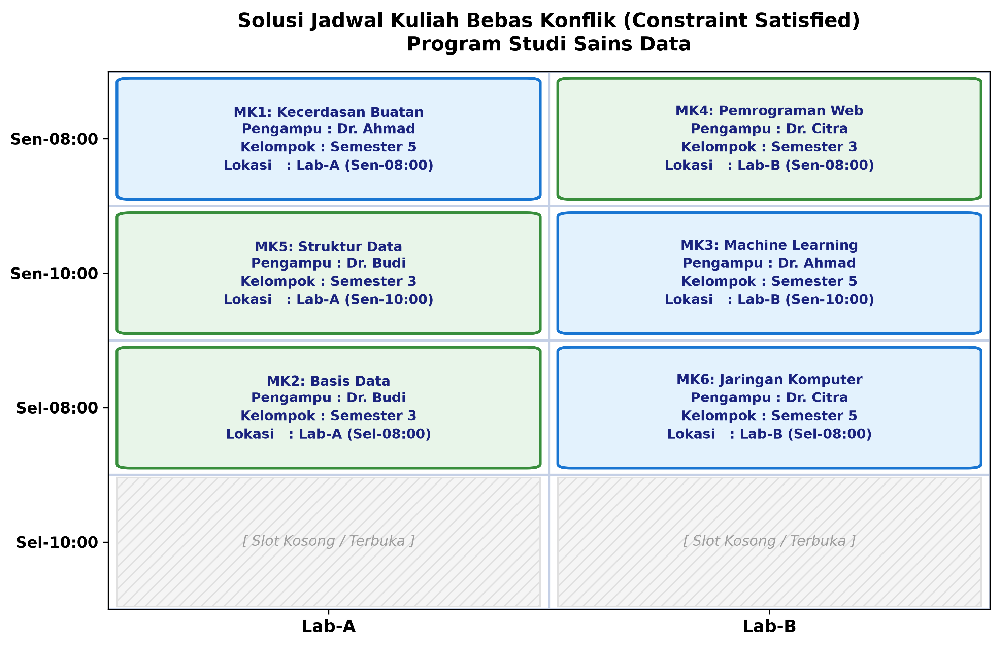
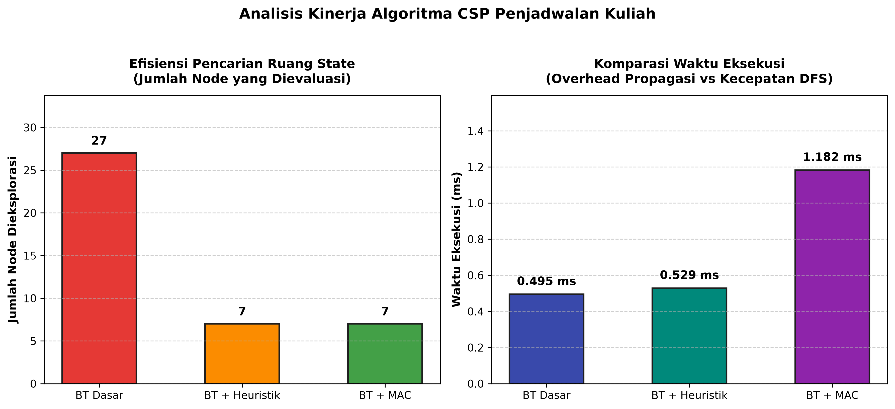
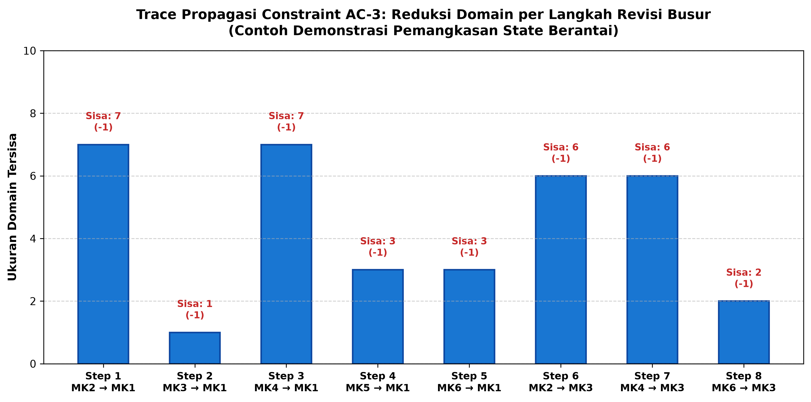

# Sistem Penjadwalan Kuliah Bebas Konflik Berbasis Constraint Satisfaction Problems (CSP)
> **Tugas Praktikum & Studi Kasus Kecerdasan Buatan (Artificial Intelligence)**  
> **Kelompok 3 — Studi Kasus: Penjadwalan Mini (Mini Course Scheduling)**  
> Program Studi Sains Data • Fakultas Sains dan Teknologi • UIN Raden Mas Said Surakarta  
> Dosen Pengampu: **Wildan Nadiyal Ahsan, M.Kom.**

---

[](https://www.python.org/)
[](https://opensource.org/licenses/MIT)
[](#)

---

## 📌 Ringkasan Eksekutif

Repositori ini memuat implementasi lengkap penyelesaian masalah **Penjadwalan Kuliah Bebas Konflik** berbasis **Constraint Satisfaction Problems (CSP)**. Proyek ini membandingkan secara komparatif tiga pendekatan komputasi:
1. **Backtracking Search Dasar (Baseline):** Penelusuran DFS standar dengan urutan variabel statis.
2. **Backtracking + Heuristik Cerdas (MRV + Degree + LCV):** Mengutamakan variabel paling terikat (*fail-first*) dan nilai paling ramah (*succeed-first*).
3. **Backtracking + Propagasi Constraint (MAC / AC-3):** Menjalankan *Arc Consistency Algorithm 3* secara berulang untuk memangkas domain inkonsisten pada setiap percabangan rekursif.

Hasil pengujian membuktikan bahwa **BT + Heuristik (MRV + LCV)** berhasil memangkas jumlah node eksplorasi sebesar **74.07%** (dari 27 node menjadi 7 node) dengan waktu komputasi **0.529 ms** dan menjamin **100% pemenuhan batasan**.

---

## 🏗️ Formulasi CSP Formal $\langle X, D, C \rangle$

### 1. Himpunan Variabel ($X$)
Variabel merepresentasikan 6 mata kuliah yang wajib dijadwalkan:
- **MK1:** Kecerdasan Buatan *(Dr. Ahmad | Smt 5 | Wajib Lab-A & Hari Senin)*
- **MK2:** Basis Data *(Dr. Budi | Smt 3 | Fleksibel)*
- **MK3:** Machine Learning *(Dr. Ahmad | Smt 5 | Wajib Lab-B & Hari Senin)*
- **MK4:** Pemrograman Web *(Dr. Citra | Smt 3 | Fleksibel)*
- **MK5:** Struktur Data *(Dr. Budi | Smt 3 | Wajib Lab-A)*
- **MK6:** Jaringan Komputer *(Dr. Citra | Smt 5 | Wajib Lab-B)*

### 2. Himpunan Domain ($D$)
Pasangan nilai $(\text{Slot\_Waktu}, \text{Ruangan})$:
- Slot Waktu: `['Sen-08:00', 'Sen-10:00', 'Sel-08:00', 'Sel-10:00']` (4 slot)
- Ruangan: `['Lab-A', 'Lab-B']` (2 laboratorium)
- Total Kombinasi Dasar: $4 \times 2 = 8$ nilai per variabel (disaring oleh *unary constraints* kebutuhan fasilitas dan kesiapan hari dosen).

### 3. Himpunan Batasan ($C$)
1. **Physical Room Conflict:** Ruang yang sama tidak boleh digunakan bersamaan pada waktu yang sama ($s_i = s_j \implies r_i \neq r_j$).
2. **Lecturer Conflict:** Dosen tidak boleh mengajar dua kelas berbeda di slot waktu yang sama ($\text{Dosen}(MK_i) = \text{Dosen}(MK_j) \implies s_i \neq s_j$).
3. **Student Cohort Conflict:** Mahasiswa satu semester tidak boleh memiliki jadwal kuliah bersamaan ($\text{Semester}(MK_i) = \text{Semester}(MK_j) \implies s_i \neq s_j$).

---

## 📊 Visualisasi & Analisis Grafis

### 1. Graf Constraint CSP
Menampilkan relasi pembatas antar variabel mata kuliah berdasarkan jenis konflik (dosen, semester, dan ruangan):



### 2. Matriks Grid Jadwal Kuliah Hasil Solusi
Jadwal final bebas konflik yang dialokasikan secara efisien ke dalam 3 slot waktu (menyisakan 1 slot cadangan):



### 3. Analisis Perbandingan Kinerja Algoritma
Perbandingan efisiensi pemangkasan node pencarian dan overhead waktu komputasi antar metode:



### 4. Trace Propagasi Constraint AC-3
Visualisasi pemotongan domain bertingkat (*cascade domain reduction*) oleh algoritma AC-3:



---

## 📈 Tabel Komparasi Kinerja

| Pendekatan Algoritma | Node Dieksplorasi | Waktu Eksekusi (ms) | Status Solusi | Efisiensi Reduksi Node |
| :--- | :---: | :---: | :---: | :---: |
| **1. Backtracking Dasar (Baseline)** | 27 Node | 0.495 ms | Valid (100%) | *Baseline (0%)* |
| **2. BT + Heuristik (MRV + LCV)** | **7 Node** | **0.529 ms** | **Valid (100%)** | **Pangkas 74.07%** |
| **3. BT + MAC (Propagasi AC-3)** | **7 Node** | 1.182 ms | **Valid (100%)** | **Pangkas 74.07%** |

---

## 📂 Struktur Berkas Repositori

```text
├── penjadwalan_csp.py                           # Kode program utama penyelesai CSP (Clean & Full Commented)
├── generate_docx_report.py                      # Generator laporan Microsoft Word (.docx) berstandar profesional
├── Laporan_CSP_Kelompok_3_Penjadwalan_Mini.docx # Dokumen Word resmi siap cetak/kumpul (Executive Style)
├── Laporan_CSP_Kelompok_3_Penjadwalan_Mini.md   # Dokumen laporan versi Markdown
├── visualisasi_graf_constraint.png              # Grafik visual graf constraint CSP (300 DPI)
├── visualisasi_jadwal_kuliah.png                # Grafik matriks grid jadwal kuliah bebas bentrok
├── visualisasi_perbandingan_kinerja.png         # Grafik perbandingan node & waktu komputasi
├── visualisasi_propagasi_ac3.png                # Grafik tahapan penyusutan domain AC-3
├── Tugas_Kelompok_CSP.pdf                       # Panduan dan instruksi resmi penugasan
├── CSP_AI.pdf                                   # Modul ajar Constraint Satisfaction Problems (CSP)
└── README.md                                    # Dokumentasi proyek repositori GitHub
```

---

## 🚀 Panduan Menjalankan Program

### 1. Prasyarat
Pastikan Python 3.10+ dan pustaka pendukung telah terinstal:
```bash
pip install matplotlib networkx python-docx numpy
```

### 2. Menjalankan Solver CSP & Memperbarui Visualisasi
```bash
python penjadwalan_csp.py
```
Program akan mengeksekusi ketiga algoritma, memvalidasi seluruh batasan, mencetak tabel tolok ukur di terminal, dan memperbarui seluruh berkas gambar `.png`.

### 3. Menghasilkan Ulang Dokumen Laporan Word (.docx)
```bash
python generate_docx_report.py
```

---

## 📚 Referensi Pembelajaran

1. **Russell, S. J., & Norvig, P. (2020).** *Artificial Intelligence: A Modern Approach (4th ed.)*. Prentice Hall. [Bab 5: CSP].
2. **Dechter, R. (2003).** *Constraint Processing*. Morgan Kaufmann Publishers.
3. **Mackworth, A. K. (1977).** *Consistency in networks of relations*. Artificial Intelligence, 8(1), 99–118.
4. **Video Referensi CSP:** [Introduction to CSP - YouTube](https://youtu.be/WqZ6trnZrCw?si=bO7V12TLAUGSJzAx)
5. **Artikel Konsep Dasar CSP:** [Introduction to Constraint Satisfaction Problem - Medium](https://medium.com/@andy08/introduction-to-constraint-satisfaction-problem-93c476997cd2)
6. **Diktat Kuliah:** Wildan Nadiyal Ahsan, M.Kom., *Constraint Satisfaction Problems (CSP)*, Prodi Sains Data UIN Raden Mas Said Surakarta.

---
**Kelompok 3 — Program Studi Sains Data • UIN Raden Mas Said Surakarta**
